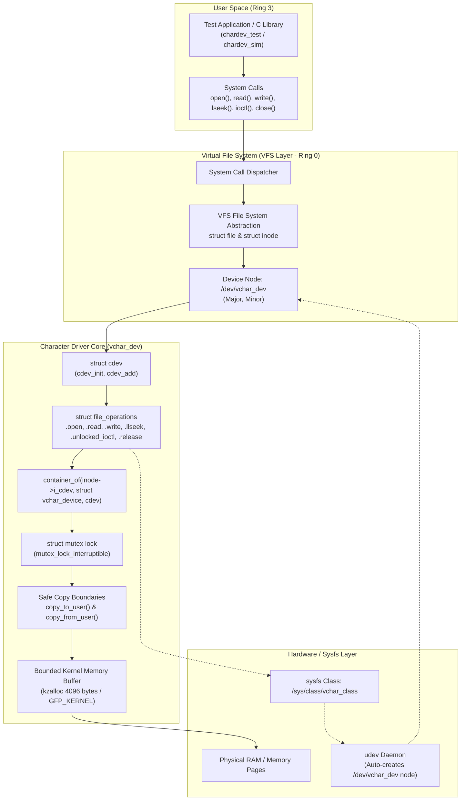

# Linux Character Device Driver Architecture

This document describes the architectural layers, data structures, and execution flow of the `vchar_dev` Linux character device driver.

---

## 1. System Architecture Diagram



---

## 2. Kernel Abstractions & Data Structures

### A. The Device Representation: `struct vchar_device`
In production Linux device drivers, global state is encapsulated inside a dedicated device struct rather than using loose global variables:

```c
struct vchar_device {
    struct cdev cdev;           /* Embedded character device abstraction */
    dev_t dev_num;              /* Dynamic Major/Minor numbers */
    struct class *class;        /* sysfs class for udev node creation */
    struct device *device;      /* sysfs device pointer */
    char *buffer;               /* Dynamically allocated page buffer */
    size_t buffer_capacity;     /* Maximum capacity (e.g. 4096 bytes) */
    size_t data_size;           /* Current bytes of valid data */
    struct mutex lock;          /* Mutex protecting shared state */
    struct vchar_stats stats;   /* Operational telemetry */
};
```

### B. Inode to Driver Resolution: `container_of()`
When user space issues `open("/dev/vchar_dev", O_RDWR)`:
1. The kernel VFS locates the corresponding `struct inode`.
2. The inode contains a pointer `inode->i_cdev` pointing to the embedded `cdev`.
3. The driver retrieves the outer enclosing `struct vchar_device` using the macro `container_of`:
   ```c
   struct vchar_device *dev = container_of(inode->i_cdev, struct vchar_device, cdev);
   file->private_data = dev;
   ```
4. For all subsequent operations (`read`, `write`, `llseek`, `ioctl`, `release`), the driver retrieves `dev = file->private_data` in $O(1)$ time without searching tables.

---

## 3. Dynamic Device Numbers & Sysfs Auto-Node Creation

### Dynamic Major Number Allocation:
- Static major numbers are prone to collision with existing drivers.
- `vchar_dev` uses `alloc_chrdev_region(&dev_num, 0, 1, DEVICE_NAME)` which dynamically assigns an unused major number from the kernel character device table.

### Automatic Device Node Creation via Sysfs & udev:
1. `class_create`: Creates a sysfs subsystem directory at `/sys/class/vchar_class`.
2. `device_create`: Creates a device entry under `/sys/class/vchar_class/vchar_dev`.
3. The userspace `udev` daemon receives the uevent broadcast by the kernel and automatically executes `mknod /dev/vchar_dev c <major> <minor>` with appropriate permissions.
