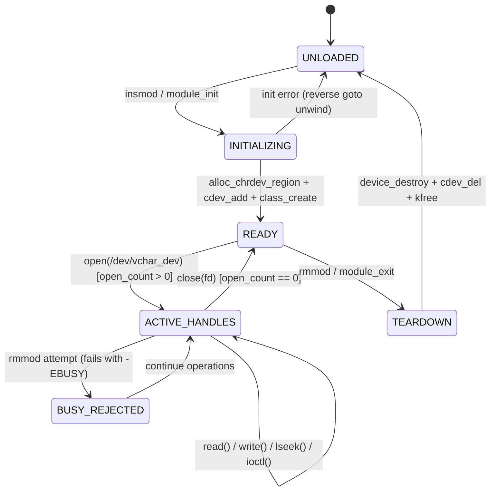

# Linux Character Device Subsystem Specification (`vchar_dev`)

**Author**: Yadul Jain  
**License**: GPL v2  
**Kernel Compatibility**: Linux 5.x / 6.x  
**Subsystem**: Character Device Core / VFS

---

## 1. System Overview & Purpose

The `vchar_dev` subsystem provides a hardened, kernel-managed character device driver designed to illustrate production-grade Linux driver architecture, virtual file system (VFS) integration, dynamic device node creation via sysfs/udev, sleepable mutual exclusion, and hardware memory boundary protections (SMAP/SMEP).

Unlike toy drivers that rely on static major numbers or global arrays, `vchar_dev` is structured around container composition (`struct vchar_device`), zero-copy-aware buffer models, and strict reverse-order unwind recovery.

---

## 2. Subsystem Finite State Machine (FSM)



---

## 3. Kernel Abstraction & Object Model

The driver models state using object composition rather than static global variables:

```c
struct vchar_device {
    struct cdev cdev;           /* VFS character device registration */
    dev_t dev_num;              /* Dynamic Major/Minor numbers (alloc_chrdev_region) */
    struct class *class;        /* sysfs class (/sys/class/vchar_class) */
    struct device *device;      /* sysfs device (/dev/vchar_dev via udev) */
    char *buffer;               /* Dynamically allocated page buffer (kzalloc) */
    size_t buffer_capacity;     /* Bounded capacity (e.g. 4096 bytes) */
    size_t data_size;           /* Valid payload high-water mark */
    struct mutex lock;          /* Sleepable serialization lock */
    struct vchar_stats stats;   /* Real-time telemetry counters */
};
```

### Inode Resolution via `container_of`
When the VFS invokes `vchar_open(struct inode *inode, struct file *file)`, it receives the generic `struct cdev` pointer embedded within `inode->i_cdev`. The driver resolves its enclosing device state in $O(1)$ time:

$$\text{dev} = \text{container\_of}(\text{inode}\to\text{i\_cdev}, \text{struct vchar\_device}, \text{cdev})$$

This base pointer is stored in `file->private_data`, ensuring zero hash-table overhead for all subsequent I/O system calls.

---

## 4. System Call Contracts

### 4.1 `open()`
- Resolves device pointer via `container_of()`.
- Acquires `mutex_lock_interruptible(&dev->lock)`. Returns `-ERESTARTSYS` on signal interruption.
- Increments `stats.open_count`.
- Releases mutex. Returns `0`.

### 4.2 `read()`
- Validates user buffer: if `!buf` returns `-EINVAL`.
- If `count == 0` returns `0`.
- Locks mutex (`mutex_lock_interruptible`).
- If `*ppos >= dev->data_size`, returns `0` (clean EOF).
- Computes transfer length: $\min(\text{count}, \text{dev}\to\text{data\_size} - *\text{ppos})$.
- Calls `copy_to_user()`. If uncopied bytes $> 0$, subtracts remainder; if $0$ bytes copied, returns `-EFAULT`.
- Advances `*ppos += transferred` and updates `stats.read_bytes`.
- Releases mutex. Returns transferred byte count.

### 4.3 `write()`
- Validates user buffer: if `!buf` returns `-EINVAL`.
- Locks mutex (`mutex_lock_interruptible`).
- Bounds check: if `*ppos >= dev->buffer_capacity`, returns `-ENOSPC`.
- Computes available space: $\min(\text{count}, \text{dev}\to\text{buffer\_capacity} - *\text{ppos})$.
- Calls `copy_from_user()`. Handles uncopied bytes with `-EFAULT` on total failure.
- Updates high-water mark: if `*ppos > dev->data_size`, sets `dev->data_size = *ppos`.
- Updates `stats.write_bytes`.
- Releases mutex. Returns written byte count.

### 4.4 `llseek()`
- Supports `SEEK_SET`, `SEEK_CUR`, and `SEEK_END`.
- Locks mutex.
- Verifies $0 \le \text{new\_pos} \le \text{buffer\_capacity}$. Rejects out-of-range offsets with `-EINVAL`.
- Updates `file->f_pos = new_pos`.
- Releases mutex. Returns `new_pos`.

### 4.5 `unlocked_ioctl()`
- `VCHAR_IOC_RESET`: Clears buffer via `memset(0)` and resets `data_size = 0`.
- `VCHAR_IOC_GET_STATS`: Exports `struct vchar_stats` safely to user space using `copy_to_user()`.
- `VCHAR_IOC_SET_LIMIT`: Dynamically adjusts active usable limit.

---

## 5. Memory Safety & Concurrency Guarantees

1. **User Memory Boundary Protection**:
   Raw pointer dereferencing (`*user_ptr`) is prohibited. All user-space transfers use `copy_to_user()` and `copy_from_user()`, adhering to hardware MMU protections:
   - **SMAP** (Supervisor Mode Access Prevention): Enforces that Ring 0 cannot access user virtual pages without explicit assembly toggles (`stac`/`clac`).
   - **SMEP** (Supervisor Mode Execution Prevention): Forbids instruction execution from user memory while executing in kernel privilege.
   - **Demand-Page Fault Recovery**: If a user buffer page is not resident in physical RAM, the kernel page fault handler resolves it transparently or returns uncopied byte counts mapped to `-EFAULT`.

2. **Mutex vs. Spinlock Invariant**:
   `copy_to_user` and `copy_from_user` can sleep when triggering demand-page I/O. Acquiring a spinlock disables kernel preemption. Calling a sleepable function with preemption disabled panics the kernel (`BUG: scheduling while atomic`). Therefore, critical sections wrapping memory copies strictly employ sleep-safe `struct mutex`.
